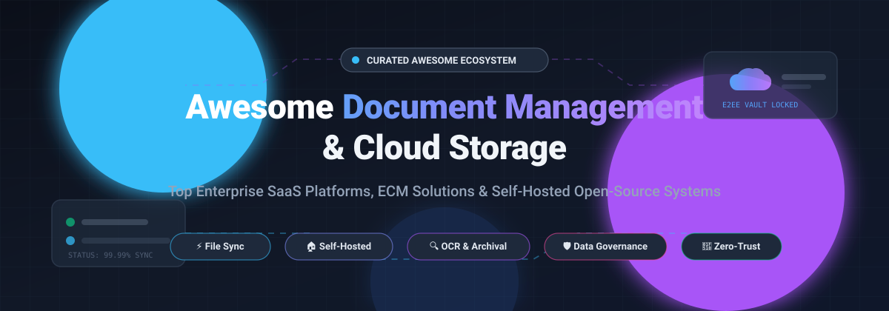

  

# Awesome Document Management & Cloud Storage

  
  
  
  
  
  

> 📚 A curated list of top SaaS platforms and open-source GitHub projects for document management, cloud file storage, enterprise content management (ECM), and self-hosted team collaboration.

Discover modern solutions for storing, syncing, sharing, indexing, and governing digital files across teams—ranging from consumer and enterprise cloud storage services to self-hosted document management systems with automated OCR, metadata taxonomy, full-text search, and regulatory compliance audit trails.

---

## 📑 Table of Contents
- [📊 Sector Overview & Market Dynamics](#-sector-overview--market-dynamics)
- [☁️ SaaS & Hosted Cloud Platforms](#️-saas--hosted-cloud-platforms)
- [💻 Open-Source GitHub Projects](#-open-source-github-projects)
- [🧭 How to Choose: Architecture & Workload Guide](#-how-to-choose-architecture--workload-guide)
- [📈 Star History](#star-history)
- [💖 Support & Sponsorship](#-support--sponsorship)
- [🤝 How to Contribute](#-how-to-contribute)
- [⚖️ Disclaimer](#️-disclaimer)

---

## 📊 Sector Overview & Market Dynamics

The global Document Management System (DMS) market is estimated at **$10–$12 billion** (projected to reach **$20–$26 billion by 2032** at an 11–13% CAGR), while the broader underlying cloud storage infrastructure market exceeds **$100 billion** tracking toward $200+ billion. 

The market dynamics exhibit **moderate fragmentation with an oligopolistic infrastructure layer**: hyperscale enterprise ecosystems (**Microsoft 365 / SharePoint / OneDrive** and **Google Workspace / Drive**) dominate general-purpose enterprise productivity and daily workplace collaboration, while the dedicated enterprise content management (ECM) and specialized workflow tier remains moderately fragmented among independent SaaS platforms (Box, Dropbox, Egnyte, ShareFile) and a vibrant, rapidly growing open-source self-hosted ecosystem addressing data sovereignty, privacy compliance (GDPR/HIPAA), and on-premise governance.

---

## ☁️ SaaS & Hosted Cloud Platforms

The table below lists leading commercial Document Management and Cloud Storage SaaS platforms, ranked descending by company size (valuation / market capitalization / enterprise scale).

| Product | Company Size / Valuation | Description | Pricing (Starting Tier) | Free Tier / Free Trial Limits |
|:---|:---|:---|:---|:---|
| **[Microsoft OneDrive](https://onedrive.live.com/)** | **~$3.1 Trillion** (Market Cap) | Cloud storage deeply woven into the Microsoft 365 ecosystem. Offers native Windows file sync, Office document co-authoring, and mobile backup. | **$1.99/month** (Standalone Basic, 100 GB) or included with M365 Business Basic from **$6.00/user/month** (annual) | **Free Forever**: 5 GB storage across personal Microsoft account. |
| **[SharePoint](https://www.microsoft.com/en-us/microsoft-365/sharepoint/collaboration)** | **~$3.1 Trillion** (Market Cap) | Enterprise document management, team sites, and intranet portal platform. Features granular permissions, metadata taxonomy, version histories, and Power Automate workflows. | Included with Microsoft 365 Business Basic at **$6.00/user/month** (annual); Standalone Plan 1 at **$5.00/user/month** (annual) | **Free Trial**: 30-day free trial of Microsoft 365 Business (up to 25 users, 1 TB OneDrive storage/user). No standalone permanent free tier. |
| **[Google Drive](https://drive.google.com/)** | **~$2.1 Trillion** (Market Cap) | Ubiquitous consumer and enterprise cloud workspace featuring real-time collaborative editing via Docs, Sheets, and Slides, alongside enterprise shared drives. | Google Workspace Business Starter at **$7.00/user/month** (billed monthly or $6.00/user/month billed annually) | **Free Forever**: 15 GB free storage shared across Google Drive, Gmail, and Google Photos. |
| **[Citrix ShareFile](https://www.sharefile.com/)** | **~$16.5 Billion** (CSG Buyout Valuation) | Secure client file transfer, virtual data room (VDR), and workflow automation platform built for accounting, legal, and financial firms. | Advanced Plan starting at **$16.50/user/month** (annual billing, 3-user minimum = $49.50/month) | **Free Trial**: 14-day free trial (up to 5 projects, 5 e-signatures, and 100 client guests). No permanent free tier. |
| **[Dropbox Business](https://www.dropbox.com/business)** | **~$7.2 Billion** (Market Cap) | Enterprise file sync and sharing solution with Smart Sync, team folders, file recovery, and deep third-party productivity integrations. | Essentials Plan at **$18.00/month** (annual, 1 user, 3 TB) or Business Standard at **$15.00/user/month** (annual, 3-user minimum, 5 TB pooled) | **Free Forever**: 2 GB free storage on personal tier; **30-day free trial** for Business Standard (5 TB storage, full team features). |
| **[Box](https://www.box.com/)** | **~$5.9 Billion** (Market Cap) | Enterprise content management (ECM) cloud platform focused on advanced governance, compliance (HIPAA, FedRAMP), e-signatures, and workflow automation. | Business Starter starting at **$5.00/user/month** (annual billing, 3-user minimum, 100 GB storage) | **Free Forever**: 10 GB free storage for individual accounts (250 MB single file upload limit); **14-day free trial** for Business plans. |
| **[Egnyte](https://www.egnyte.com/)** | **~$1.5 Billion** (Valuation) | Content governance, hybrid-cloud file sharing, and sensitive data discovery platform designed for regulated industries (life sciences, AEC, finance). | Business Plan starting at **$22.00/user/month** (annual billing, up to 100 users, 1 TB base + 10 GB/user) | **Free Trial**: 15-day free trial (20 GB storage limit, up to 1 GB upload file limit). No permanent free tier. |

---

## 💻 Open-Source GitHub Projects

Curated open-source projects for self-hosted document storage, cloud workspaces, electronic document records management (EDRMS), and continuous multi-device file synchronization. 

*Ranked descending by GitHub Stargazers:*

| Project | GitHub_Stars | Description | Focus / Key Capabilities |
|:---|:---|:---|:---|
| **[Syncthing](https://github.com/syncthing/syncthing)** |  | Continuous, peer-to-peer decentralized file synchronization protocol and engine. | **P2P Continuous Sync**: Syncs files across desktop, mobile, and server nodes without passing through a third-party central server; TLS encryption and block-level transfer. |
| **[Rclone](https://github.com/rclone/rclone)** |  | "The Swiss army knife of cloud storage" — command-line program to manage and sync files on cloud storage. | **Multi-Cloud Sync & FUSE Mount**: Supports 70+ cloud storage backends (S3, B2, Google Drive, OneDrive); provides file encryption, cache, and mount capabilities. |
| **[Paperless-ngx](https://github.com/paperless-ngx/paperless-ngx)** |  | OCR-driven document archive and indexing system for indexing paper receipts, invoices, and PDF/A records. | **Archival & OCR Search**: Automated OCR via Tesseract, ML-powered auto-tagging, PDF/A conversion, multi-format consumption directory, and full-text search. |
| **[Nextcloud Server](https://github.com/nextcloud/server)** |  | Leading open-source on-premises content collaboration platform and private cloud workspace. | **All-in-One Cloud Suite**: Self-hosted file sync and share, calendar, contacts, Talk (video meetings), and web office integration via Collabora or OnlyOffice; AGPLv3. |
| **[File Browser](https://github.com/filebrowser/filebrowser)** |  | Sleek, lightweight web-based file manager and browser running from a standalone Go binary. | **Lightweight File Management**: Create users, browse directories, edit files, and generate custom share links directly over an existing filesystem without heavy services. |
| **[Ente Photos & Drive](https://github.com/ente-io/ente)** |  | End-to-end encrypted (E2EE) alternative to Google Photos and cloud storage drives. | **Zero-Knowledge Encryption**: End-to-end encrypted file and media storage across web, desktop, and mobile with verifiable open-source cryptography. |
| **[Cloudreve](https://github.com/cloudreve/Cloudreve)** |  | Modern self-hosted file management system with multi-storage backend drivers (Local, S3, OneDrive). | **Multi-Storage Gateway**: Exposes unified cloud storage web interface powered by Go; supports direct uploads to S3/WebDAV, link sharing, and offline download tasks. |
| **[Cryptomator](https://github.com/cryptomator/cryptomator)** |  | Multi-platform client-side transparent encryption tool for cloud storage vaults. | **Client-Side Cloud Encryption**: AES-256 client-side vault encryption that works seamlessly on top of Dropbox, Google Drive, OneDrive, or Nextcloud. |
| **[Seafile](https://github.com/haiwen/seafile)** |  | High-performance open-source cloud file sync and storage platform optimized for large libraries. | **Block-Level High Speed Sync**: Content-defined block storage model with Git-like commit history, data deduplication, and encrypted libraries; ideal for millions of files. |
| **[Teedy](https://github.com/sismics/docs)** |  | Modern, lightweight document management system (formerly Sismics Docs) with integrated OCR. | **Lightweight Team DMS**: Automated OCR (tesseract), full-text search, video/audio/PDF preview, metadata extraction, and tag hierarchy packaged in Java/Docker. |
| **[Docspell](https://github.com/eikek/docspell)** |  | Personal and small-organization document organizer and digital filing cabinet. | **Automated Ingestion**: Ingests files via scanner, webhooks, or email; automatic text extraction (OCR), machine-learning classification, and multi-user support. |
| **[Pydio Cells](https://github.com/pydio/cells)** |  | Enterprise-grade document sharing, collaborative spaces, and content services platform written in Go. | **Enterprise Content Services**: Microservice architecture, OpenID Connect authentication, granular security policies, S3 backend compliance, and cell-based collaboration. |
| **[ownCloud Infinite Scale (oCIS)](https://github.com/owncloud/ocis)** |  | Microservices-based cloud collaboration and data platform written in Go with cloud-native storage. | **Cloud-Native Spaces**: Eliminates traditional database bottlenecks via Reva storage engine; native OIDC identity integration and Spaces architecture for enterprise scale. |
| **[Sync-in](https://github.com/Sync-in/server)** |  | Modern self-hosted collaborative file storage platform with strong identity and office suite integration. | **Modern Nextcloud Alternative**: AGPL-3.0; native OIDC/LDAP auth, MFA, Collabora/OnlyOffice co-authoring, Spaces & Shares RBAC, and full-text document indexing. |
| **[Mayan EDMS](https://github.com/mayan-edms/mayan-edms)** |  | Enterprise Electronic Document Management System (EDMS) for compliance, auditing, and lifecycle control. | **Enterprise Document Governance**: 90+ modules, multi-stage workflows, digital signatures, legal hold retention policies, metadata schemas, and complete audit tracking. |
| **[LogicalDOC Community](https://github.com/logicaldoc/community)** |  | Java-based open-source document management system with web UI, indexing, and workflow automation. | **Structured DMS**: Web-based document repository, version control, full-text Lucene indexing, role-based access permissions, and mobile client connectivity. |

---

## 🧭 How to Choose: Architecture & Workload Guide

When designing an organizational document infrastructure or selecting a cloud storage stack, consider the distinct operational boundaries between daily file sync and document archiving:

1. ⚡ **Daily Teamwork & Multi-Device Sync:**
   - For complete collaborative workspaces replacing Google Drive / Microsoft 365, pick **Nextcloud** (all-in-one suite) or **ownCloud Infinite Scale (oCIS)** (lean, high-throughput Go architecture).
   - For rapid synchronization of massive repositories containing millions of files, choose **Seafile** (block-level deduplication) or **Syncthing** (peer-to-peer decentralized sync).
   - For multi-cloud management and server backup staging, deploy **Rclone**.

2. 🔍 **Digital Archiving, Invoices & OCR Document Governance:**
   - For digitizing household receipts, statements, and organizational invoices, use **Paperless-ngx** (automatic Tesseract OCR and PDF/A archiving) or **Docspell**.
   - For legal, healthcare, or financial compliance requiring multi-stage approval workflows, granular role-based access control (RBAC), and digital signatures, deploy **Mayan EDMS** or **LogicalDOC**.

3. 🔐 **Privacy & Client-Side Encryption:**
   - To add zero-knowledge encryption on top of existing cloud drives (Dropbox, OneDrive, Google Drive), utilize **Cryptomator**.
   - For end-to-end encrypted personal media and file storage, evaluate **Ente**.

---

## 📈 Star History

---

## 💖 Support & Sponsorship

Thank you so much for exploring this ecosystem! If you found this curated list helpful for your projects, infrastructure, or team, please consider supporting its continued maintenance:

- ⭐ **Star this repository** to help others discover it on GitHub.
- 🍴 **Fork and contribute** new open-source projects or SaaS updates.
- 📢 **Share with your colleagues** in DevOps, SysAdmin, and developer communities.
- ☕ **Buy me a coffee & become a sponsor**: Support ongoing research and maintenance directly via the [GitHub Sponsor Dashboard](https://github.com/sponsors/ishandutta2007).

---

## 🤝 How to Contribute

Contributions, project additions, and corrections are welcome!
1. Fork this repository.
2. Add your suggested platform or update existing details in [README.md](file:///C:/Users/ishan/Documents/Projects/Awesome-Document-Management-Cloud-Storage/README.md).
3. Ensure SaaS additions include precise starting pricing, free tier/trial limits, and company valuation data. Open-source projects must include their GitHub stargazer badge linking to stargazers.
4. Submit a pull request with a concise summary of changes.

---

## ⚖️ Disclaimer

- This list is community-maintained for informational and architectural comparison purposes.
- Document and cloud storage systems manage critical and regulated business data. Always implement strict role-based access control (RBAC), automated offsite backups, and end-to-end encryption in transit and at rest.
